# TechSolutions - Sistema de gestion de servicios tecnologicos

**Parcial II - Programacion II (16 de octubre de 2026)**
Facultad de Ingenieria - Programa de Ingenieria de Sistemas y Computacion.

Aplicacion de escritorio desarrollada en **Java + JavaFX** con arquitectura
**MVC**, que administra los servicios tecnologicos de la empresa TechSolutions:
catalogo y personalizacion de servicios, configuracion de paquetes tecnologicos,
registro de solicitudes y consulta de tecnicos mediante una plataforma externa.

> Documentacion del codigo: **todas las clases, metodos y decisiones de diseno
> estan comentados en espanol dentro del propio codigo fuente** (`src/main/java`).
> Este archivo es la guia general del proyecto.

---

## 1. Requisitos

| Herramienta | Version recomendada | Notas |
|---|---|---|
| JDK | 17 o superior | Probado con JDK 21 (Eclipse Adoptium). El `pom.xml` compila con `release 17`. |
| IntelliJ IDEA | Community o Ultimate | Community es suficiente. |
| JavaFX | 21.0.6 | **Se descarga automaticamente** con Maven (no hay que instalarlo a mano). |
| Maven | Se incluye el **wrapper** (`mvnw` / `mvnw.cmd`) | No es necesario tener Maven instalado. |

No se requiere Python, ni Gradle, ni configurar el SDK de JavaFX manualmente.

---

## 2. Como ejecutar el proyecto

### 2.1 Abrir en IntelliJ IDEA

1. **File > Open...** y seleccionar la carpeta del proyecto (la que contiene
   `pom.xml`).
2. IntelliJ detecta que es un proyecto Maven y descarga las dependencias
   (JavaFX) automaticamente. Aceptar cuando pregunte **"Trust Project"** o
   **"Load Maven Project"**.
3. Esperar a que termine la importacion (barra de progreso abajo a la derecha).

### 2.2 Ejecutar la interfaz grafica (aplicacion JavaFX)

**Opcion A - Configuracion incluida (la mas facil).**
En la lista de configuraciones (arriba a la derecha) elegir
**`TechSolutions (JavaFX)`** y pulsar **Run** (verde). Esa configuracion ya trae
los objetivos Maven `clean javafx:run`.

**Opcion B - Panel Maven.**
Abrir el panel **Maven** (lado derecho) > `techsolutions` > `Plugins` >
`javafx` > doble clic en **`javafx:run`**.

**Opcion C - Terminal.**
```powershell
# Windows (PowerShell / CMD)
.\mvnw.cmd clean javafx:run

# macOS / Linux
./mvnw clean javafx:run
```

Se abrira una ventana con cuatro pestanas, una por funcionalidad:

1. **Servicios** - consultar/crear servicios y personalizarlos con complementos.
2. **Paquetes** - crear paquetes y anidarlos (servicios, personalizados y paquetes).
3. **Solicitudes** - registrar, confirmar y ver el costo total.
4. **Tecnicos** - consultar la disponibilidad en la plataforma externa
   `LegacySupport`.

### 2.3 Ejecutar la demostracion por consola (opcional, sin interfaz)

Sirve como prueba rapida de que la logica funciona (14 comprobaciones).

**Opcion A - Desde IntelliJ.** Elegir la configuracion **`Demo consola`** y Run.

**Opcion B - Terminal.**
```powershell
.\mvnw.cmd -q compile exec:java
# o, sin Maven:
java -cp target\classes com.techsolutions.consola.DemoConsola
```

### 2.4 Compilar / empaquetar

```powershell
.\mvnw.cmd clean package        # genera target/techsolutions-1.0.0.jar
```
Tambien hay una configuracion de ejecucion **`Verificar build (package)`**.

---

## 3. Estructura del proyecto (arquitectura MVC)

```
TechSolutions/
├── pom.xml                     Configuracion Maven (Java 17 + JavaFX + plugins)
├── mvnw / mvnw.cmd             Maven wrapper (no requiere Maven instalado)
├── .mvn/wrapper/               Configuracion del wrapper
├── .run/                       Configuraciones de ejecucion de IntelliJ IDEA
├── README.md                   Este archivo
└── src/main/java/com/techsolutions/
    ├── Main.java                    Punto de entrada JavaFX (Application)
    ├── modelo/                      MODELO: dominio del negocio
    │   ├── ComponenteServicio.java      Interfaz comun (Component de Composite/Decorator)
    │   ├── ServicioTecnico.java         Clase base de los servicios individuales
    │   ├── MantenimientoPreventivo.java     ($80.000,  no presencial)
    │   ├── MantenimientoCorrectivo.java     ($120.000, presencial / MANTENIMIENTO)
    │   ├── InstalacionRedes.java            ($180.000, presencial / REDES)
    │   ├── RecuperacionInformacion.java     ($150.000, presencial / RECUPERACION_DATOS)
    │   ├── PaqueteTecnologico.java      Composite: agrupa componentes
    │   ├── complemento/
    │   │   ├── ComplementoServicio.java     Decorator (clase base)
    │   │   ├── AtencionPrioritaria.java     (+$35.000)
    │   │   ├── SoporteTecnico30Dias.java    (+$50.000)
    │   │   └── AtencionDomicilio.java       (+$25.000)
    │   ├── Cliente.java                 Documento, nombre, correo
    │   ├── Solicitud.java               Solicitud + Builder
    │   ├── Especialidad.java            Enum (codigoLegacy + nombreVisible)
    │   ├── TecnicoEspecializado.java    Tecnico estructurado (del adaptador)
    │   ├── ConsultaTecnicos.java        Resultado de la consulta de tecnicos
    │   ├── ProveedorTecnicos.java       Interfaz (puerto) hacia el proveedor externo
    │   ├── Prioridad.java               Enum BAJA/MEDIA/ALTA
    │   └── EstadoSolicitud.java         Enum REGISTRADA/CONFIRMADA/NO_CONFIRMADA
    ├── fabricas/                    PATRONES CREACIONALES (Factory Method + Singleton)
    │   ├── FabricaServicio.java             Fabrica abstracta de servicios
    │   ├── FabricaMantenimientoPreventivo.java
    │   ├── FabricaMantenimientoCorrectivo.java
    │   ├── FabricaInstalacionRedes.java
    │   ├── FabricaRecuperacionInformacion.java
    │   ├── CatalogoFabricas.java            Singleton: registro de fabricas de servicios
    │   ├── FabricaComplemento.java          Fabrica abstracta de complementos
    │   ├── FabricaAtencionPrioritaria.java
    │   ├── FabricaSoporteTecnico30Dias.java
    │   ├── FabricaAtencionDomicilio.java
    │   └── CatalogoComplementos.java        Singleton: registro de fabricas de complementos
    ├── servicio/                    Logica de aplicacion (fachadas de las funcionalidades)
    │   ├── CatalogoServicios.java       Singleton: catalogo de servicios (precargado)
    │   ├── CatalogoClientes.java        Singleton: clientes precargados
    │   ├── ServicioCatalogo.java        Func. 1: consultar/crear servicios
    │   ├── ServicioPersonalizacion.java Func. 1: aplicar complementos (Decorator)
    │   ├── ServicioPaquetes.java        Func. 2: crear/componer paquetes (Composite)
    │   ├── RepositorioSolicitudes.java  Almacen en memoria + codigo unico
    │   └── ServicioSolicitudes.java     Func. 3 y 4: registrar/confirmar/costo/tecnicos
    ├── integracion/                 Integracion con el sistema externo
    │   ├── LegacySupport.java            Plataforma externa (NO modificable)
    │   └── AdaptadorLegacySupport.java   PATRON ADAPTER (traduce en ambos sentidos)
    ├── controlador/                 CONTROLADOR: une vista y modelo
    │   ├── ControladorPrincipal.java    Composition root: arma todo el MVC
    │   ├── ControladorServicios.java
    │   ├── ControladorPaquetes.java
    │   ├── ControladorSolicitudes.java
    │   └── ControladorTecnicos.java
    ├── vista/                       VISTA: interfaz JavaFX (sin logica de negocio)
    │   ├── VistaPrincipal.java          TabPane con las 4 pestanas
    │   ├── VistaServicios.java
    │   ├── VistaPaquetes.java
    │   ├── VistaSolicitudes.java
    │   ├── VistaTecnicos.java
    │   └── Alertas.java                 Utilidad para dialogos de error/informacion
    ├── excepciones/                 Errores esperados del negocio
    │   ├── TechSolutionsException.java      Razon comun (Exception marcada)
    │   ├── ValidacionException.java         Datos obligatorios / formato invalido
    │   ├── PaqueteCiclicoException.java     Paquete dentro de si mismo
    │   └── TecnicoNoDisponibleException.java No hay tecnico para atender
    ├── util/
    │   └── Formato.java                 Formato de moneda ($ 80.000) y fecha
    └── consola/
        └── DemoConsola.java             Demostracion por consola (sin JavaFX)
```

### Como se cumple MVC

- **Modelo** (`modelo`, `fabricas`, `servicio`, `integracion`): todo el dominio y
  las reglas de negocio. **No conoce JavaFX.**
- **Vista** (`vista`): solo construye los controles de la interfaz y expone
  *getters* de sus widgets. **No contiene reglas de negocio ni calculos.**
- **Controlador** (`controlador`): escucha los eventos de la vista, llama a los
  servicios del modelo, actualiza la vista y muestra los mensajes. Es el unico
  que conoce tanto a la vista como al modelo.

Al construir las vistas **por codigo** (sin FXML) el MVC queda explicito y no
depende de rutas de recursos que suelen fallar al compilar o empaquetar.

---

## 4. Patrones de diseno aplicados

| Patron | Tipo | Donde | Para que |
|---|---|---|---|
| **Singleton** | Creacional | `CatalogoServicios`, `CatalogoClientes`, `CatalogoFabricas`, `CatalogoComplementos` | Un unico catalogo/registro compartido por toda la aplicacion. |
| **Factory Method** | Creacional | `FabricaServicio` + 4 fabricas; `FabricaComplemento` + 3 fabricas | Crear servicios/complementos sin que el resto del sistema dependa de las clases concretas. Agregar un tipo nuevo = agregar una fabrica y registrarla. |
| **Builder** | Creacional | `Solicitud.Builder` | Construir solicitudes con datos obligatorios validados y datos opcionales encadenables. Hace imposible crear una solicitud incompleta. |
| **Composite** | Estructural | `PaqueteTecnologico` (+ `ComponenteServicio`) | Tratar un paquete igual que un servicio y calcular el costo en cualquier numero de niveles. |
| **Decorator** | Estructural | `ComplementoServicio` + 3 complementos | Agregar caracteristicas complementarias al costo sin modificar la definicion original del catalogo, y poder acumular varias. |
| **Adapter** | Estructural | `AdaptadorLegacySupport` (implementa `ProveedorTecnicos`) | Integrar la plataforma externa `LegacySupport` traduciendo nombre->codigo y texto->objeto. |

---

## 5. Principios SOLID aplicados

| Principio | Como se aplica (ejemplos) |
|---|---|
| **S - Responsabilidad unica** | Cada clase hace una cosa: `RepositorioSolicitudes` solo almacena, `ServicioSolicitudes` solo aplica reglas, `Formato` solo da formato, cada `Vista*` solo dibuja su pestana. |
| **O - Abierto/cerrado** | Nuevos servicios (=nueva `FabricaServicio`), nuevos complementos (=nueva `FabricaComplemento`) y nuevos proveedores (=nueva implementacion de `ProveedorTecnicos`) **sin tocar** el catalogo, los paquetes, las solicitudes ni la interfaz. |
| **L - Sustitucion de Liskov** | `PaqueteTecnologico`, `ComplementoServicio` y todos los `ServicioTecnico` se usan indistintamente como `ComponenteServicio` (en paquetes y solicitudes). |
| **I - Segregacion de interfaces** | `ComponenteServicio` y `ProveedorTecnicos` declaran solo lo necesario; nadie se ve obligado a implementar metodos que no usa. |
| **D - Inversion de dependencias** | `ServicioSolicitudes` recibe un `ProveedorTecnicos` (abstraccion), no `LegacySupport`. `ControladorPrincipal` (composition root) decide la implementacion concreta y la inyecta. |

---

## 6. Mapeo de requisitos -> clases

| Funcionalidad / regla del enunciado | Donde se implementa |
|---|---|
| Consultar servicios disponibles y crearlos por tipo | `ServicioCatalogo`, `CatalogoServicios`, fabricas |
| Incorporar complementos mostrando base, incrementos y costo final | `ServicioPersonalizacion`, `ComplementoServicio` y sus 3 subclases |
| Los complementos NO alteran el catalogo | `ComplementoServicio` decora una copia; el catalogo queda intacto (`DemoConsola` lo comprueba) |
| Crear paquetes con servicios, personalizados u otros paquetes | `ServicioPaquetes`, `PaqueteTecnologico` |
| Consultar componentes y calcular costo en varios niveles | `PaqueteTecnologico.calcularCosto`, `ServicioPaquetes.describirComposicion` |
| Impedir un paquete dentro de si mismo (directa/indirecta) | `PaqueteTecnologico.agregar` + `contieneA` -> `PaqueteCiclicoException` |
| Registrar solicitudes con codigo unico, fecha, cliente, elementos y costo | `ServicioSolicitudes`, `RepositorioSolicitudes`, `Solicitud` |
| Datos obligatorios validados; opcionales (fecha, observaciones, prioridad) | `Solicitud.Builder` + `ValidacionException` |
| Consultar tecnicos con LegacySupport y visualizar la respuesta | `AdaptadorLegacySupport`, `VistaTecnicos`, `ControladorTecnicos` |
| Verificar tecnico antes de confirmar si es presencial; informar y evitar confirmacion | `ServicioSolicitudes.confirmar` -> `TecnicoNoDisponibleException`, `EstadoSolicitud.NO_CONFIRMADA` |
| Costo total con servicios, paquetes, complementos y desplazamiento **sin duplicados** | `Solicitud.calcularCostoTotal`, `ConsultaTecnicos` (un solo desplazamiento: el mayor) |
| Clientes precargados, sin CRUD | `CatalogoClientes` |
| Incorporar nuevos tipos sin cambios significativos | Patrones Factory Method + Adapter + interfaces |

---

## 7. Reglas de negocio clave

- **Costo base por servicio:** preventivo $80.000, correctivo $120.000,
  instalacion de redes $180.000, recuperacion de informacion $150.000.
- **Complementos:** atencion prioritaria +$35.000, soporte tecnico 30 dias
  +$50.000, atencion a domicilio +$25.000. Se pueden acumular.
- **Atencion presencial:** el mantenimiento correctivo, la instalacion de redes
  y la recuperacion de informacion requieren tecnico presencial. El
  mantenimiento **preventivo se presta de forma remota** (no requiere tecnico).
- **Desplazamiento:** se cobra **una sola vez por solicitud** (se toma el mayor
  valor reportado por el proveedor), evitando cargos duplicados.
- **Recuperacion de informacion:** la plataforma externa simula que **no hay
  tecnico**, lo que permite demostrar que el sistema informa la situacion y
  **no confirma** la solicitud.
- **Codigo unico de solicitud:** lo genera `RepositorioSolicitudes` con el
  formato `SOL-001`, `SOL-002`, ...

---

## 8. Datos precargados

**Servicios (catalogo):**

| Codigo | Nombre | Costo base | Presencial | Especialidad |
|---|---|---|---|---|
| SRV-PRE | Mantenimiento preventivo | $80.000 | No | - |
| SRV-COR | Mantenimiento correctivo | $120.000 | Si | MANTENIMIENTO (101) |
| SRV-RED | Instalacion de redes | $180.000 | Si | REDES (202) |
| SRV-REC | Recuperacion de informacion | $150.000 | Si | RECUPERACION_DATOS (303) |

**Complementos:** Atencion prioritaria (+$35.000), Soporte tecnico 30 dias
(+$50.000), Atencion a domicilio (+$25.000).

**Clientes:** Ana Maria Gomez (1020304050), Carlos Perez Rios (1030405060),
Laura Torres (1040506070).

**Plataforma externa LegacySupport (respuestas simuladas):**

| Codigo de especialidad | Respuesta cruda |
|---|---|
| 101 (MANTENIMIENTO) | `TEC-105\|DISPONIBLE\|30000` |
| 202 (REDES) | `TEC-210\|DISPONIBLE\|45000` |
| 303 (RECUPERACION_DATOS) | `SIN_TECNICO\|NO_DISPONIBLE\|0` |

---

## 9. Diagrama de clases

El siguiente diagrama se puede renderizar en <https://mermaid.live> (copiar y
pegar) y exportar como imagen para el documento del parcial.

```mermaid
classDiagram
    direction TB

    class ComponenteServicio {
        <<interface>>
        +getCodigo() String
        +getNombre() String
        +getDescripcion() String
        +calcularCosto() double
        +requiereAtencionPresencial() boolean
        +getEspecialidadesRequeridas() Set~Especialidad~
        +contieneA(ComponenteServicio objetivo) boolean
    }

    class ServicioTecnico {
        <<abstract>>
        -String codigo
        -String nombre
        -String descripcion
        -double costoBase
        -Set~Especialidad~ especialidades
        +getCostoBase() double
        +calcularCosto() double
    }

    class MantenimientoPreventivo
    class MantenimientoCorrectivo
    class InstalacionRedes
    class RecuperacionInformacion

    class PaqueteTecnologico {
        -String codigo
        -String nombre
        -String descripcion
        -List~ComponenteServicio~ componentes
        +agregar(ComponenteServicio c)
        +getComponentes() List~ComponenteServicio~
        +calcularCosto() double
    }

    class ComplementoServicio {
        <<abstract>>
        #ComponenteServicio servicioContratado
        +getIncremento() double
        +getNombreComplemento() String
    }

    class AtencionPrioritaria {
        +INCREMENTO$ double
    }
    class SoporteTecnico30Dias {
        +INCREMENTO$ double
    }
    class AtencionDomicilio {
        +INCREMENTO$ double
    }

    ComponenteServicio <|.. ServicioTecnico
    ComponenteServicio <|.. PaqueteTecnologico
    ComponenteServicio <|.. ComplementoServicio
    ServicioTecnico <|-- MantenimientoPreventivo
    ServicioTecnico <|-- MantenimientoCorrectivo
    ServicioTecnico <|-- InstalacionRedes
    ServicioTecnico <|-- RecuperacionInformacion
    ComplementoServicio <|-- AtencionPrioritaria
    ComplementoServicio <|-- SoporteTecnico30Dias
    ComplementoServicio <|-- AtencionDomicilio
    PaqueteTecnologico o-- "0..*" ComponenteServicio : contiene
    ComplementoServicio o-- "1" ComponenteServicio : decora

    class Cliente {
        -String documento
        -String nombreCompleto
        -String correo
    }

    class Solicitud {
        -String codigo
        -LocalDate fechaCreacion
        -Cliente cliente
        -List~ComponenteServicio~ elementos
        -LocalDate fechaProgramada
        -String observaciones
        -Prioridad prioridad
        -EstadoSolicitud estado
        -double costoDesplazamiento
        +calcularCostoElementos() double
        +calcularCostoTotal() double
        +requiereAtencionPresencial() boolean
        +confirmar(double, TecnicoEspecializado)
        +marcarNoConfirmada()
    }
    class Builder {
        +agregarElemento(ComponenteServicio) Builder
        +conFechaProgramada(LocalDate) Builder
        +conObservaciones(String) Builder
        +conPrioridad(Prioridad) Builder
        +construir() Solicitud
    }
    class Prioridad {
        <<enumeration>>
        BAJA
        MEDIA
        ALTA
    }
    class EstadoSolicitud {
        <<enumeration>>
        REGISTRADA
        CONFIRMADA
        NO_CONFIRMADA
    }
    class Especialidad {
        <<enumeration>>
        MANTENIMIENTO
        REDES
        RECUPERACION_DATOS
        +getCodigoLegacy() int
    }
    class TecnicoEspecializado {
        -String identificador
        -Especialidad especialidad
        -boolean disponible
        -double costoDesplazamiento
    }

    Solicitud --> "1" Cliente : realizada por
    Solicitud --> "1..*" ComponenteServicio : incluye
    Solicitud ..> Builder : se crea con
    Solicitud --> "1" Prioridad
    Solicitud --> "1" EstadoSolicitud
    Solicitud ..> TecnicoEspecializado : tecnico asignado
    TecnicoEspecializado --> "1" Especialidad
    ServicioTecnico ..> "0..*" Especialidad : requiere
    MantenimientoPreventivo ..|> ComponenteServicio
    MantenimientoCorrectivo ..|> ComponenteServicio
    InstalacionRedes ..|> ComponenteServicio
    RecuperacionInformacion ..|> ComponenteServicio

    class ProveedorTecnicos {
        <<interface>>
        +consultar(Especialidad) TecnicoEspecializado
    }
    class AdaptadorLegacySupport {
        -LegacySupport plataformaLegacy
        +consultar(Especialidad) TecnicoEspecializado
    }
    class LegacySupport {
        +consultarDisponibilidadTecnico(int) String
    }
    ProveedorTecnicos <|.. AdaptadorLegacySupport
    AdaptadorLegacySupport --> "1" LegacySupport : adapta

    class FabricaServicio {
        <<abstract>>
        +crear(String,String,String,double) ServicioTecnico
        +crearConValoresPorDefecto() ServicioTecnico
    }
    FabricaServicio ..> ServicioTecnico : crea
    FabricaServicio <|-- FabricaMantenimientoPreventivo
    FabricaServicio <|-- FabricaMantenimientoCorrectivo
    FabricaServicio <|-- FabricaInstalacionRedes
    FabricaServicio <|-- FabricaRecuperacionInformacion

    class FabricaComplemento {
        <<abstract>>
        +aplicarA(ComponenteServicio) ComplementoServicio
    }
    FabricaComplemento <|-- FabricaAtencionPrioritaria
    FabricaComplemento <|-- FabricaSoporteTecnico30Dias
    FabricaComplemento <|-- FabricaAtencionDomicilio

    class ServicioSolicitudes {
        +registrar(Cliente,List,LocalDate,String,Prioridad) Solicitud
        +confirmar(Solicitud) Solicitud
        +consultarTecnicos(Solicitud) ConsultaTecnicos
    }
    ServicioSolicitudes ..> ProveedorTecnicos
    ServicioSolicitudes ..> RepositorioSolicitudes
    ServicioSolicitudes ..> FabricaServicio
    ServicioSolicitudes ..> FabricaComplemento
```



---

## 10. Verificacion (demostracion por consola)

`DemoConsola` ejecuta las cuatro funcionalidades y realiza **14 comprobaciones**
automaticas (todas correctas). Ejemplos de lo que demuestra:

1. El catalogo lista los 4 servicios con sus costos base y marca cuales son
   presenciales.
2. Crear un servicio nuevo con su fabrica (**Factory Method**).
3. Personalizar el mantenimiento correctivo con 2 complementos: base
   $120.000 + $35.000 + $50.000 = **$205.000**, y comprobar que el catalogo
   **sigue valiendo $120.000** (**Decorator**).
4. Armar un paquete empresarial que contiene un paquete de mantenimiento:
   costo **$530.000** en varios niveles (**Composite**) y bloquear un ciclo.
5. Registrar una solicitud **sin elementos** y comprobar que se bloquea
   (**Builder** + validacion).
6. Mostrar la traduccion del **Adapter**: el legado responde
   `TEC-105|DISPONIBLE|30000` y el sistema recibe un objeto estructurado.
7. Confirmar una solicitud presencial (desplazamiento una sola vez),
   **no** confirmar la de recuperacion (sin tecnico) y confirmar la no
   presencial (sin desplazamiento).

---

## 11. Checklist de las tres evidencias (enunciado)

Este repositorio cubre la evidencia 2; el documento y el video se entregan por
separado (Google Classroom).

- [ ] **Evidencia 1 - Documento:** pensamiento computacional, analisis,
      elementos del dominio, **diagrama de clases** (exportar el de la seccion 9),
      relaciones y multiplicidades.
- [x] **Evidencia 2 - Repositorio:** implementacion completa del diagrama,
      SOLID + patrones creacionales y estructurales, organizacion del codigo,
      interfaz JavaFX y estructura MVC. *(este proyecto)*
      - [ ] Subir a GitHub e incluir commits identificables de **ambos**
            integrantes.
- [ ] **Evidencia 3 - Video de sustentacion (YouTube):** con audio y video,
      ambos integrantes visibles, explicando analisis, diagrama, codigo, SOLID,
      MVC y demostrando la interfaz.

---

## 12. Nota sobre tildes y caracteres especiales

Para evitar problemas de codificacion entre sistemas operativos, **los fuentes
Java y este README estan escritos en ASCII** (sin tildes ni enes): "Programacion",
"codigo", "espanol", etc. El formato de moneda en pantalla si muestra el simbolo
`$` con separador de miles, y las fechas en formato `dd/MM/yyyy`.

Si se desea, se pueden agregar tildes a los textos de la interfaz mas adelante:
el proyecto ya declara `UTF-8` como codificacion de los fuentes en `pom.xml`.

---

## 13. Comandos utiles (resumen)

```powershell
.\mvnw.cmd clean javafx:run     # ejecutar la interfaz JavaFX
.\mvnw.cmd exec:java            # ejecutar la demo por consola
.\mvnw.cmd clean package        # compilar y empaquetar (target/*.jar)
.\mvnw.cmd clean compile        # solo compilar
```

---

*Proyecto academico - Programacion II - Parcial II - 2026.*
